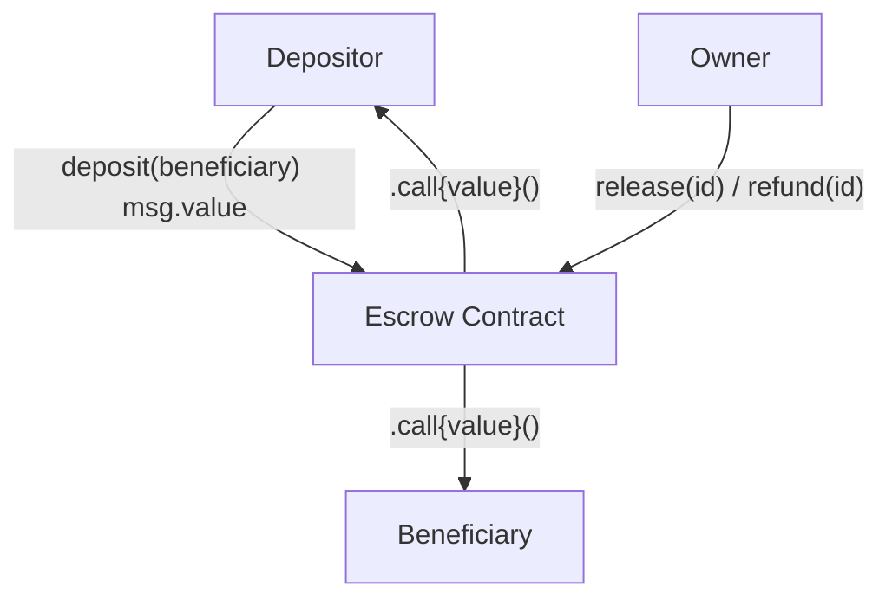

# Escrow Contract Design Document

**Status:** Draft  
**Target Chain:** Arc Testnet (EVM-compatible, USDC-as-native-gas)  
**Language / Toolchain:** Solidity 0.8.28, Foundry (forge)  
**Milestone:** v1.0 — immutable, single-owner, multi-escrow  

## Review Tracker

| Review | Owner | Status |
|---|---|---|
| Design | TBD | ☐ |
| Security | TBD | ☐ |
| Ops | TBD | ☐ |

---

## Action Items (living)

_Empty at draft. Filled after each review round._

---

## 1. Goals / Non-Goals

### Goals
- Allow any depositor to create a named escrow, locking native Arc gas (USDC-as-gas) for a named beneficiary.
- Allow the contract owner to release locked funds to the beneficiary or refund them to the depositor.
- Support multiple simultaneous independent escrows, each identified by a unique `uint256` ID.
- Emit events for every state transition so off-chain systems can track escrow lifecycle.
- Prevent reentrancy, double-release, and unauthorized state changes.

### Non-Goals
- No ERC-20 token support in this version (native Arc gas only).
- No deadline/auto-release mechanic — all releases are owner-gated.
- No dispute/arbitration process beyond the owner's discretion.
- No upgradeability — the contract is immutable once deployed.
- No fee collection by the contract.

---

## 2. Requirements

### Functional
- FR-1: Any EOA or contract may call `deposit(beneficiary)` with `msg.value > 0` to create a new escrow.
- FR-2: Each escrow stores: `id`, `depositor`, `beneficiary`, `amount`, `state` (Pending | Released | Refunded).
- FR-3: `release(id)` sends `amount` to the beneficiary and marks state `Released`.
- FR-4: `refund(id)` sends `amount` back to the depositor and marks state `Refunded`.
- FR-5: `release` and `refund` are callable only by the owner.
- FR-6: Only escrows in state `Pending` may be released or refunded (no double-action).
- FR-7: The owner may be transferred to a new address (two-step: `transferOwnership` + `acceptOwnership`).

### Security
- SR-1: No path other than `release` or `refund` (owner-only) can move escrowed funds.
- SR-2: CEI (Checks-Effects-Interactions) ordering must be respected on every fund-movement function.
- SR-3: `nonReentrant` guard on all external-call sites (`release`, `refund`).
- SR-4: Zero-address is rejected for `beneficiary` at deposit time.
- SR-5: Depositing zero value is rejected.
- SR-6: Owner is never set to the zero address (Ownable2Step prevents this).
- SR-7: `renounceOwnership` is disabled — the contract would be permanently locked if called.

---

## 3. Terminology & Actors

| Term | Definition |
|---|---|
| Escrow | A single fund-holding agreement identified by a unique ID |
| Depositor | The address that sends funds into an escrow |
| Beneficiary | The address that receives funds when an escrow is released |
| Owner | The privileged address that can release or refund any escrow |
| State | Lifecycle position of an escrow: Pending → Released or Refunded |

### Actors

| Actor | On/Off-chain | Trust Level | Capabilities |
|---|---|---|---|
| Owner | Off-chain EOA / multisig | Trusted | `release`, `refund`, `transferOwnership` |
| Depositor | On-chain EOA or contract | Untrusted | `deposit` (create escrow with own funds) |
| Beneficiary | On-chain EOA or contract | Untrusted | Receives funds on `release` |
| Anyone | On-chain | Untrusted | `getEscrow` (view), event observation |

---

## 4. Language / Runtime

- **Solidity 0.8.28** — locked compiler; checked arithmetic by default; `uint` overflow reverts.
- **EVM hardfork:** Paris (Arc Testnet `evm_version = "paris"` in `foundry.toml`). No Cancun/Shanghai-only opcodes used.
- **Base contracts:** OpenZeppelin 5.1.0 (`Ownable2Step`, `ReentrancyGuard`) — pinned version compatible with Paris EVM.
- `Ownable2Step` chosen over `Ownable`: prevents ownership loss from a mistyped transfer address.

---

## 5. Transaction & Execution Model

Execution is atomic — all state mutations commit or all revert.

**Re-entry surface:** `release` and `refund` both call `.call{value:}("")` on untrusted addresses (beneficiary / depositor), which is the primary reentrancy vector.

**CEI discipline:**
1. **Checks** — validate state, ownership, amount.
2. **Effects** — update `escrow.state` to `Released` / `Refunded`, decrement `totalLocked`.
3. **Interactions** — `.call{value:}("")` to transfer funds.

`nonReentrant` is applied as a belt-and-suspenders guard on top of CEI.

---

## 6. Chain Standards & Interfaces

No ERC token standard implemented. Native Arc gas (USDC-as-gas) is transferred via `msg.value` / `.call{value:}`.

Arc-specific note: on Arc, the native gas token IS USDC. There is a single pool — no separate "ETH" and "USDC" balance. This contract holds and moves only the native view (gas units), so no ERC-20 transfer or approval is needed.

---

## 7. Architecture Overview

### Component Diagram



### Fund Flow

| Step | Actor | Action | Invariant |
|---|---|---|---|
| 1 | Depositor | `deposit(beneficiary)` with `msg.value` | `totalLocked` increases by `msg.value`; escrow state = Pending |
| 2a | Owner | `release(id)` | State set to Released BEFORE `.call`; `totalLocked` decreases |
| 2b | Owner | `refund(id)` | State set to Refunded BEFORE `.call`; `totalLocked` decreases |
| End | — | — | `address(this).balance == totalLocked` (resting-state invariant) |

**Resting-state invariant:** `address(this).balance == totalLocked` — every native token in the contract is accounted for by a Pending escrow.

---

## 8. Contract Design

### Roles

| Role | Holder | Count | Permissions | Rationale |
|---|---|---|---|---|
| Owner | Single EOA (or multisig) | 1 | `release`, `refund`, `transferOwnership` | Single arbitrator for all escrows |
| Depositor | Any address | N | `deposit` (own funds only) | Permissionless deposit |

### Storage Layout

```solidity
// EscrowLib (inlined into Escrow.sol — not upgradeable, no gap needed)

enum State { Pending, Released, Refunded }

struct EscrowData {
    address depositor;    // slot field
    address beneficiary;  // slot field
    uint256 amount;       // full slot
    State   state;        // packed with next field if any
}

// Escrow contract storage
uint256 public escrowCount;            // incremented per deposit; used as next ID
uint256 public totalLocked;            // sum of all Pending escrow amounts
mapping(uint256 => EscrowData) private _escrows;

// Ownable2Step storage (inherited): _owner, _pendingOwner
// ReentrancyGuard storage (inherited): _status
```

### Modifiers

| Modifier | Guard |
|---|---|
| `onlyOwner` | Caller must be current owner (from Ownable2Step) |
| `nonReentrant` | Re-entry blocked via status flag (from ReentrancyGuard) |

### Functions — Write

| Function | Caller | State Mutated | Events | Revert Conditions |
|---|---|---|---|---|
| `deposit(address beneficiary)` payable | Anyone | Creates new `EscrowData`; increments `escrowCount`, `totalLocked` | `EscrowCreated(id, depositor, beneficiary, amount)` | `beneficiary == address(0)`, `msg.value == 0` |
| `release(uint256 id)` | Owner only | Sets `state = Released`; decrements `totalLocked`; sends `amount` to beneficiary | `EscrowReleased(id, beneficiary, amount)` | Not owner; escrow not Pending; transfer fails |
| `refund(uint256 id)` | Owner only | Sets `state = Refunded`; decrements `totalLocked`; sends `amount` to depositor | `EscrowRefunded(id, depositor, amount)` | Not owner; escrow not Pending; transfer fails |
| `transferOwnership(address)` | Owner only | Sets `_pendingOwner` | `OwnershipTransferStarted` (OZ) | Not owner |
| `acceptOwnership()` | Pending owner | Sets `_owner`, clears `_pendingOwner` | `OwnershipTransferred` (OZ) | Not pending owner |
| `renounceOwnership()` | Disabled | — | — | Always reverts |

### Functions — Read

| Function | Returns | Notes |
|---|---|---|
| `getEscrow(uint256 id)` | `EscrowData` | Returns full struct; reverts if ID out of range |
| `escrowCount()` | `uint256` | Total escrows ever created (IDs are 0-based) |
| `totalLocked()` | `uint256` | Sum of all Pending escrow amounts |
| `owner()` | `address` | Current owner |
| `pendingOwner()` | `address` | Pending owner (if a transfer is in progress) |

### Events

| Event | Params | When |
|---|---|---|
| `EscrowCreated` | `uint256 indexed id, address indexed depositor, address indexed beneficiary, uint256 amount` | On `deposit` |
| `EscrowReleased` | `uint256 indexed id, address indexed beneficiary, uint256 amount` | On `release` |
| `EscrowRefunded` | `uint256 indexed id, address indexed depositor, uint256 amount` | On `refund` |

---

## 9. Deployment & Initialization

- **Constructor:** Sets `owner` to `msg.sender` (via `Ownable(msg.sender)`). No other initializer needed — immutable contract.
- **Deploy-time parameters:** Owner address (constructor arg). No other config.
- **Deterministic addressing:** Not required for v1. Standard `CREATE` deployment.
- **Init runbook:** Deploy → confirm owner address → transfer ownership to production key if needed.
- **Post-deploy balance:** Zero. The contract holds no funds at genesis.
- **Key at genesis:** Deployer wallet (Circle-managed testnet deployer on testnet; production key on mainnet).

---

## 10. Upgradeability

Not upgradeable. Contract is immutable.

**Migration story:** If a bug requires a fix, deploy a new contract at a new address. Pending escrows on the old contract must be manually refunded by the old owner before the old contract is abandoned. Integrators re-point to the new address.

---

## 11. Key Management & Signing

No off-chain signatures in this contract — all privileged actions require an on-chain `msg.sender` check.

Owner key responsibilities: `release`, `refund`, ownership transfer. Compromise of the owner key allows an attacker to release all Pending escrows to beneficiaries (not steal to attacker-controlled addresses, since beneficiaries are set at deposit time) or refund all escrows to depositors. This is not a fund-theft vector, but it is a griefing vector for ongoing escrow agreements.

**Recommendation:** Use a multisig or hardware-wallet key for the owner on any production deploy.

---

## 12. Security Considerations

| Vulnerability | Applicable? | Mitigation |
|---|---|---|
| Reentrancy | Yes — `.call{value}()` in `release` and `refund` | CEI ordering + `nonReentrant` on both functions |
| Access control | Yes — `release`/`refund` are owner-only | `onlyOwner` modifier; Ownable2Step; `renounceOwnership` disabled |
| Integer overflow/underflow | Solidity 0.8 checked by default | No `unchecked` blocks used |
| Unchecked external call | Yes — `.call` return value | Return value checked; revert on failure |
| Fee-on-transfer / rebasing tokens | N/A — native gas only, not ERC-20 | — |
| Signature replay | N/A — no off-chain signatures | — |
| Front-running / MEV | Low — owner decides release/refund; no race condition | Escrow state is explicit; no ambiguous ordering |
| Flash-loan / price manipulation | N/A — no price oracle | — |
| Oracle manipulation | N/A | — |
| Denial of service | Low — beneficiary or depositor is a contract that reverts | Pull-over-push not applicable here (owner pushes); revert on failed `.call` surfaces the issue cleanly |
| Delegatecall / proxy safety | N/A — not upgradeable | — |
| Timestamp / block dependence | N/A — no time-based logic | — |
| Approval persistence | N/A — native gas only | — |
| Centralization risk | Yes — single owner controls all releases | Documented in threat model; recommend multisig for production; two-step ownership transfer reduces mis-key risk |
| Zero-value deposit | Yes | Reverts if `msg.value == 0` |
| Zero-address beneficiary | Yes | Reverts if `beneficiary == address(0)` |
| Stuck funds from failed `.call` | Yes | Revert on failed `.call` (no silent failure); funds remain Pending and owner can retry |

---

## 13. Trust Model & Threat Analysis

| Actor | Max damage if compromised | Mitigation | Detection |
|---|---|---|---|
| Owner key | Release all Pending escrows to their beneficiaries; or refund all to depositors. Cannot redirect funds to attacker (beneficiary is immutable per escrow). | Multisig / hardware wallet; two-step transfer | Monitor `EscrowReleased` / `EscrowRefunded` events for unexpected bulk activity |
| Depositor | Can create escrows with their own funds only; no impact on other escrows | No mitigation needed (untrusted but bounded) | Event monitoring |
| Beneficiary | Receives funds only via owner action; a malicious beneficiary contract can revert `.call`, causing `release` to fail | Owner can refund instead if beneficiary blocks release | Monitor revert traces on `release` |

---

## 14. Emergency Response

No `pause` function in v1 (single-owner model keeps complexity low). Emergency responses:

- **Owner key compromised:** Transfer ownership to a new key ASAP. Attacker can only redirect releases/refunds to their correct parties, not steal.
- **Stuck escrow (beneficiary reverts on `.call`):** Owner calls `refund(id)` to return funds to the depositor.
- **Bug discovered post-deploy:** Deploy new contract; refund all Pending escrows via the current owner key; migrate.

---

## 15. Failure Scenarios

| Scenario | Behaviour | Safety |
|---|---|---|
| `release` called on already-released escrow | Reverts: state ≠ Pending | No double-payment |
| `refund` called after `release` | Reverts: state ≠ Pending | No double-payment |
| Beneficiary contract reverts on `.call` | `release` reverts; escrow stays Pending; owner can retry or `refund` | Funds never lost |
| Owner calls `release` with wrong ID | Reverts: invalid ID (amount == 0 case handled) | No-op |
| Ownership transfer to wrong address | Two-step: wrong address can't `acceptOwnership`; current owner retains control | No permanent loss |

---

## 16. Priorities & Tradeoffs

| Decision | Tradeoff | Rationale | Rejected Alternative |
|---|---|---|---|
| Owner-only release/refund | Centralization risk | Simplest safe arbitration model for v1 | Both-parties-approve: more complex; deadlock if one party ghosts |
| Native gas (not ERC-20) | Limits token flexibility | Matches Arc's USDC-as-gas model; avoids `SafeERC20` complexity | ERC-20: adds approval flow, fee-on-transfer risk |
| Immutable contract | No hot-upgrades | Safer; no proxy attack surface | UUPS: upgradeable but adds admin key risk |
| Pull-over-push not used | Owner must push funds | Owner controls timing; simplifies UX | Pull pattern: depositor/beneficiary must call claim; more gas-efficient but worse UX |
| `renounceOwnership` disabled | Owner can't self-destruct role | Prevents permanent contract lock | Enabled: unrecoverable if called accidentally |

---

## 17. Testing Strategy

- **Unit tests (Foundry `.t.sol`):** Happy path for `deposit`, `release`, `refund`; all revert paths; event assertions; fuzz on `amount` and `id`; invariant: `address(this).balance == totalLocked` after any sequence of calls.
- **Static analysis (Slither):** Run against production contract; treat High as blocking.
- **Coverage target:** 100% branch coverage on the production contract.
- **Run command:** `forge test -vv && forge test --mt invariant` (invariant suite separate).
- **Deploy gate:** All tests green + Slither clean before deploy.

---

## 18. Third-Party Libraries

| Library | Version | Already a dep? | Why chosen | Security reviewed? |
|---|---|---|---|---|
| `@openzeppelin/contracts` | 5.1.0 | Yes (pinned in package.json) | Industry-standard; `Ownable2Step`, `ReentrancyGuard` | Yes (OpenZeppelin audited releases) |

---

## 19. Monitoring & Alerting

| Event | Threshold | Severity | Action |
|---|---|---|---|
| `EscrowReleased` | Unexpected bulk release (>5 in 1 block) | High | Investigate owner key compromise |
| `EscrowRefunded` | Unexpected bulk refund | High | Investigate owner key compromise |
| `EscrowCreated` | Unusual deposit sizes | Medium | Monitor for anomalies |
| `OwnershipTransferred` | Any | Critical | Verify new owner is expected; rotate if not |

---

## 20. Common Patterns / Worked Examples

### Example 1 — Happy Path Release

1. Alice calls `deposit(bob)` with 100 native gas units → `EscrowCreated(0, alice, bob, 100)`.
2. Owner calls `release(0)` → state set to `Released`, `totalLocked -= 100`, `.call{value:100}(bob)` → `EscrowReleased(0, bob, 100)`.
3. `address(this).balance == totalLocked == 0`.

### Example 2 — Refund Path

1. Alice calls `deposit(bob)` with 50 → `EscrowCreated(1, alice, bob, 50)`.
2. Dispute arises. Owner calls `refund(1)` → state = `Refunded`, funds return to Alice → `EscrowRefunded(1, alice, 50)`.

### Example 3 — Double-Release Attempt

1. Owner calls `release(0)` (already Released) → reverts with `EscrowNotPending`.
